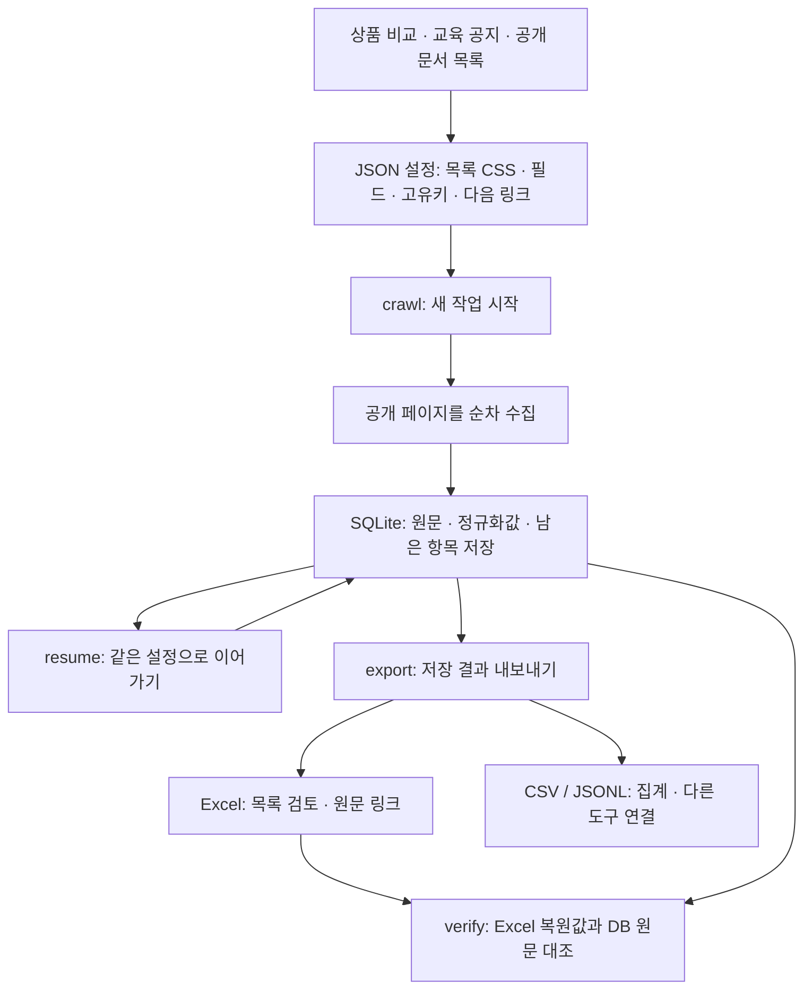
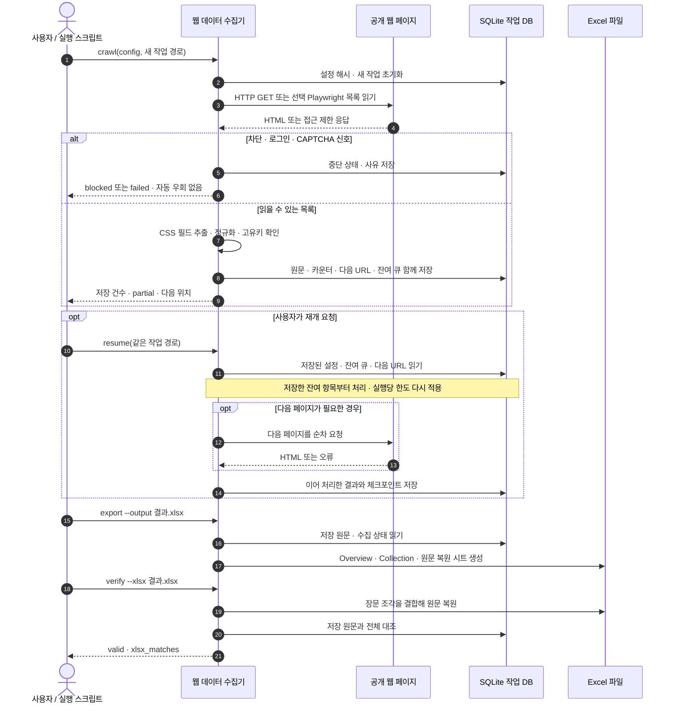

# 웹 데이터 수집기 — 개발자용 상세 흐름

[처음 사용하는 분을 위한 안내](../README.md#한눈에-보는-사용-흐름)에서는 네 단계로 사용 방법을 설명합니다. 아래 도표는 코드를 연결하거나 수정할 때 참고하는 처리 순서입니다.

## 한눈에 보는 사용 흐름

상품·교육 공지·문서 목록에 맞게 CSS 설정을 작성하면 수집·재개·Excel 검증을 같은 명령으로 처리합니다. AI 서비스나 브라우저 자동화는 기본 실행에 필요하지 않습니다.

### 수집·중단·재개·원문 확인 순서

저장된 잔여 항목만 처리하면 재개 중 새 웹 요청은 필요하지 않습니다. `verify`는 저장·내보내기의 일치를 확인하며 사이트 전체 수집을 보증하지 않습니다. 새 시점 조사는 새 작업 DB로 시작합니다. [시나리오별 활용](recipes.md)에서 설정과 실행 예를 확인하세요.

